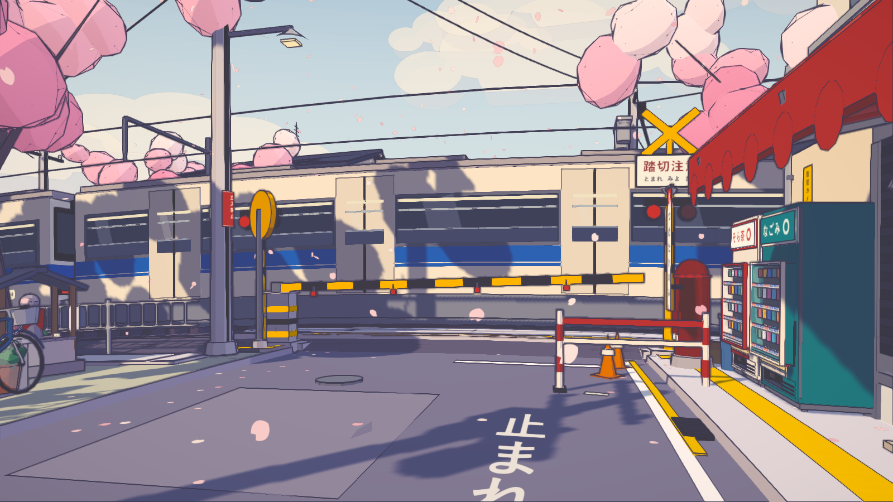
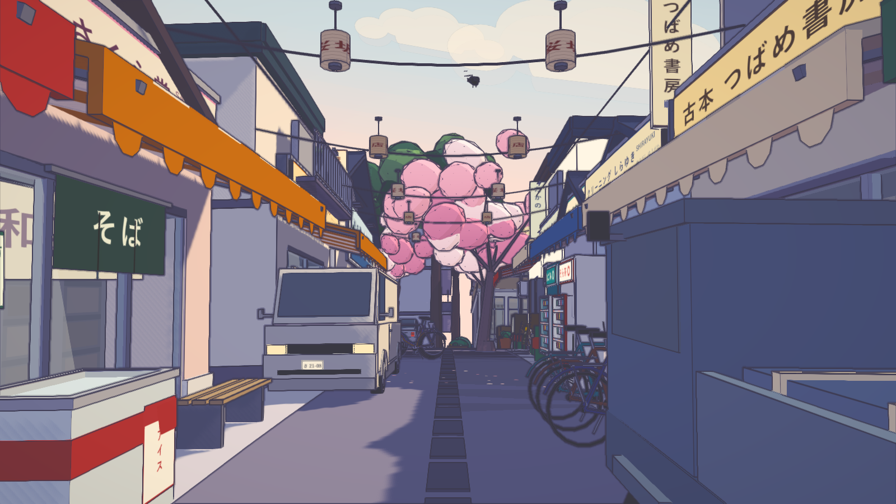
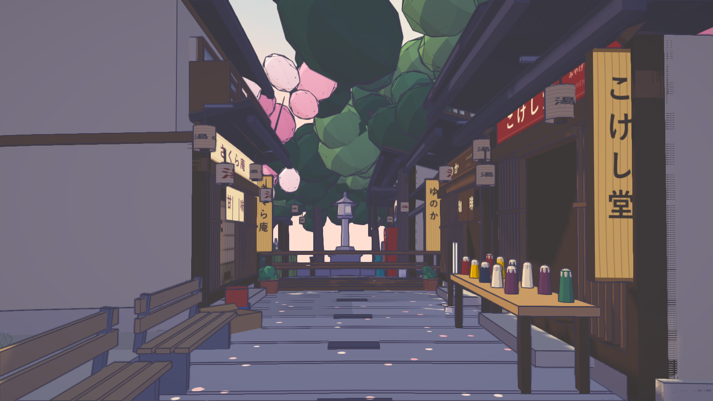
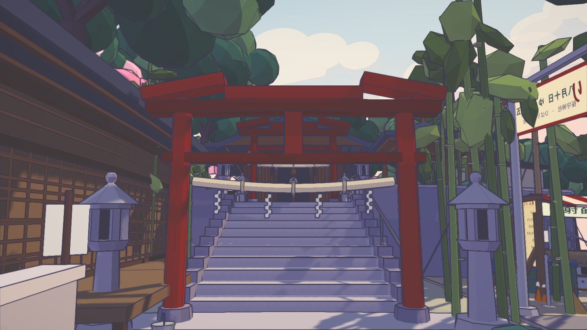

# Sakura Crossing — Scala 3 + Scala.js + Laminar + Three.js

**[Live Interactive Demo → https://miueon.github.io/sakura-crossing-scalajs/](https://miueon.github.io/sakura-crossing-scalajs/)**

A procedural anime-NPR 3D Japanese railway crossing and neighborhood built in **Scala 3.8**, **Scala.js 1.22**, **Laminar 17**, **Ultraviolet** (typed Scala 3 → GLSL shader DSL), and **Three.js r185** — with **zero external 3D model or texture assets** and **zero hand-written JavaScript facade boilerplate**.

> **Early Flagship Showcase for _Facade Contract_ (Coming Soon)**
>
> This repository is an early real-world showcase of **Facade Contract**, our upcoming next-generation TypeScript-to-Scala.js binding toolchain.
>
> From a single two-line shim ([`src/main/shims/vendor/three.ts`](src/main/shims/vendor/three.ts)) containing `export * from "three";`, **Facade Contract** synthesized and contract-verified all **1,042 Scala 3 facade files** committed under [`src/main/scala-generated/vendor/three/`](src/main/scala-generated/vendor/three/).
>
> **Facade Contract** is currently in pre-release development and will be open-sourced soon — stay tuned!

---

## Screenshots (Live Scala.js + WebGL Renders)

| **1. 桜坂踏切 — The Level Crossing** | **2. さくら坂商店街 — Sakurazaka Shotengai** |
| :---: | :---: |
|  |  |
| **3. 湯の坂温泉街 — Yunosaka Onsen** | **4. 桜守神社 — Sakuramori Shrine** |
|  |  |

---

## Why _Facade Contract_ Instead of ScalablyTyped?

Anyone who has used **ScalablyTyped** on modern TypeScript libraries (`three`, `@ai-sdk/*`, modern UI kits) knows the friction:

1. **Transitive Universe Explosion**: Pointing ScalablyTyped at a single npm package drags in a massive transitive `@types/*` graph (including its own parallel `typings.std` / DOM universe), generating tens of thousands of files, bloating sbt compile times, and bringing IDE indexing (Metals) to its knees.
2. **Mangled, Unidiomatic Output**: Syntactic AST translation produces deeply nested `Anon_*` bags, builder boilerplate, and erased workarounds that feel nothing like modern Scala 3.
3. **Blind Translation vs. Verified Contracts**: Complex TypeScript type relations (`keyof`, indexed access, conditional and mapped types, overloaded constructors) frequently degrade to `js.Any` or emit signatures that compile in Scala but subtly diverge from what the upstream TypeScript checker actually permits.
4. **All-or-Nothing Lock-in**: You either accept the entire generated `typings.*` monolith or fall back to writing `@js.native` traits by hand.

| Dimension | Hand-Written `@js.native` | ScalablyTyped | **Facade Contract (Previewed Here)** |
| :--- | :--- | :--- | :--- |
| **Authoring Effort** | Thousands of lines of manual traits | Config + transitive `@types` wrestling | **2 lines (`export * from "three"`)** or surgical curation |
| **Correctness Guarantee** | Unchecked (human guesswork) | Best-effort syntactic AST translation | **Contract-verified against upstream TypeScript semantics** |
| **Scala 3 Output Quality** | Clean, but incomplete & drifts | Mangled `Anon_*` & parallel `typings.std` | **Flat, idiomatic Scala 3.8 (`vendor.three.*`, native unions)** |
| **DOM & Stdlib Interop** | Direct `scalajs-dom` | Parallel generated DOM types | **Direct `scalajs-dom` & standard Scala.js types** |
| **Build & IDE Footprint** | Fast, but manual | Heavy JVM heap & slow indexing | **Bounded closure (1,042 readable `.scala` files)** |

Browse [`src/main/scala-generated/vendor/three/`](src/main/scala-generated/vendor/three/) in this repo to see the difference first-hand: clean, human-readable Scala 3 classes and traits that integrate directly with `scalajs-dom` and compile out of the box.

---

## Architecture & Engineering Highlights

### 1. Whole-Package `export * from "three"` -> 1,042 Scala 3 Facades
Look inside [`src/main/shims/vendor/three.ts`](src/main/shims/vendor/three.ts):

```ts
/// <reference types="facade-contract/shim-v2" />
const _pkg = Scala.package("vendor.three", { module: "three" });
export * from "three";
```

Nothing in `three` was hand-written for this project. Every `WebGLRenderer`, `WebGLRenderTarget`, `DepthTexture`, `MeshToonMaterial`, `DataTexture`, `InstancedMesh`, `BufferGeometry`, `DirectionalLight`, `Matrix4`, and `Quaternion` used across the 28 Scala world and rendering modules comes directly from the generated Scala 3 sources in [`src/main/scala-generated/vendor/three/`](src/main/scala-generated/vendor/three/). Because those generated `.scala` sources are committed in this repository, you can clone and run `sbt fullLinkJS` immediately without needing the pre-release generator installed locally.

### 2. Typed Scala 3 Shaders via Ultraviolet
All custom GLSL shaders are authored in Scala 3 using [**Ultraviolet**](https://github.com/PurpleKingdomGames/ultraviolet) and compiled to GLSL at compile time:
- **`PostPipeline.scala`** — A 3-pass offscreen `WebGLRenderTarget` + `DepthTexture` post-processing pipeline:
  1. **Screen-space depth-second-difference ink pass (`inkFragmentShader`)**: linearizes depth and detects convex crease edges across pixel neighborhoods.
  2. **Anime color-grading pass (`gradeFragmentShader`)**: applies cool violet shadow tinting (`0xada8d0`), warm sunlight highlights (`0xfff7e8`), saturation boost, vignette, and linear-to-sRGB gamma encoding.
  3. **Edge-directed FXAA pass (`fxaaFragmentShader`)**: smooths high-contrast toon and outline edges.
- **`core/Outline.scala` & `core/Toon.scala`** — Clip-space smoothed-normal inverted-hull outline shells (`hullOutline`) paired with 3- and 4-band `DataTexture` `MeshToonMaterial` cel shading and Ultraviolet-patched violet shadow tinting (`lights_toon_pars_fragment`).

### 3. Spherical Planet Bake ($R = 160\text{ m}$) & Zero External Assets
- **Spherical World (`world/Planet.scala`)**: All 11 districts (`Street`, `Railway`, `Train`, `Shop`, `Shrine`, `Shotengai`, `RestCorner`, `Library`, `NorthBlock`, `Matsuri`, `Onsen`, `Alleys`, `District`, `Traffic`, `Details`) are authored in flat $(x, y, z)$ coordinates and CPU-baked onto a true $R = 160\text{ m}$ sphere (`bakeToPlanet` with edge subdivision at $\le 4.0\text{ m}$), producing **1,379 top-level scene nodes, 7,980 meshes, 9,667 instanced elements, 2,298,028 vertices, and 753,239 baked triangles**.
- **65+ Procedural Canvas2D Textures (`core/Textures.scala`)**: Every Japanese shop fascia (`青空商店`, `古本 つばめ書房`, `クリーニング しらゆき`, `さくら庵`, `こけし堂`, `ひばり台図書館`, `米・酒 なかの`), noren curtain (`そば`, `ゆ`), festival banner (`八月十五日`, `射的`), road marking (`止まれ`, `踏切注意`), license plate (`さ 21-08`), and wood/tatami/shoji grain is painted procedurally in Scala via HTML5 Canvas2D.
- **Laminar 17 Reactive Controls (`app/`)**: Reactive `Var`/`Signal` state drives keyboard locomotion (`WASD` / Arrow keys, `Shift` sprint, canal water swimming state), 9 camera presets (`1`–`9`), and clean WebGL/DOM listener lifecycle teardown.

---

## Quick Start (Local Development)

### Prerequisites
- **JDK 21+** and **sbt 2.x** (or `sbt` launcher)
- **Node.js 22+** and **pnpm**

### 1. Install dependencies & run the dev server
```bash
pnpm install
sbt fastLinkJS
pnpm run dev
```
Then open **[http://localhost:5274/](http://localhost:5274/)**.

### 2. Run the test suite
```bash
sbt "testOnly *"
```

### 3. Build the production static bundle (`dist/`)
```bash
pnpm run build
pnpm run preview
```

---

## Credits & Attribution

- Original 3D world design, procedural art direction, and reference implementation by [**Kenton-GMI/sakura-crossing**](https://github.com/Kenton-GMI/sakura-crossing).
- Scala 3 / Scala.js / Laminar / Ultraviolet port and **Facade Contract** whole-package Three.js showcase by [**@miueon**](https://github.com/miueon).
